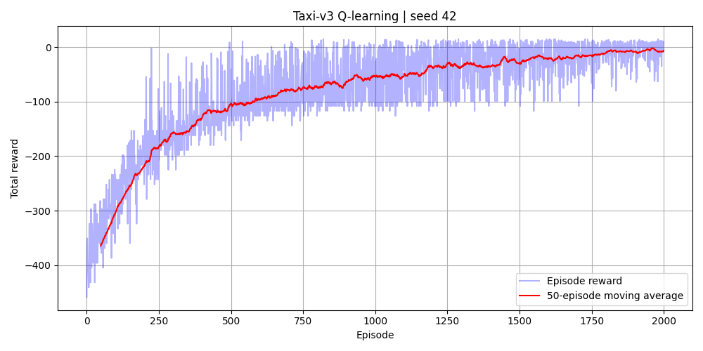
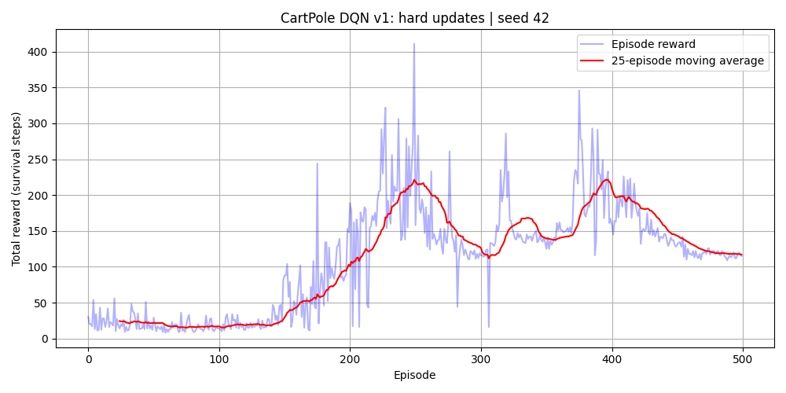
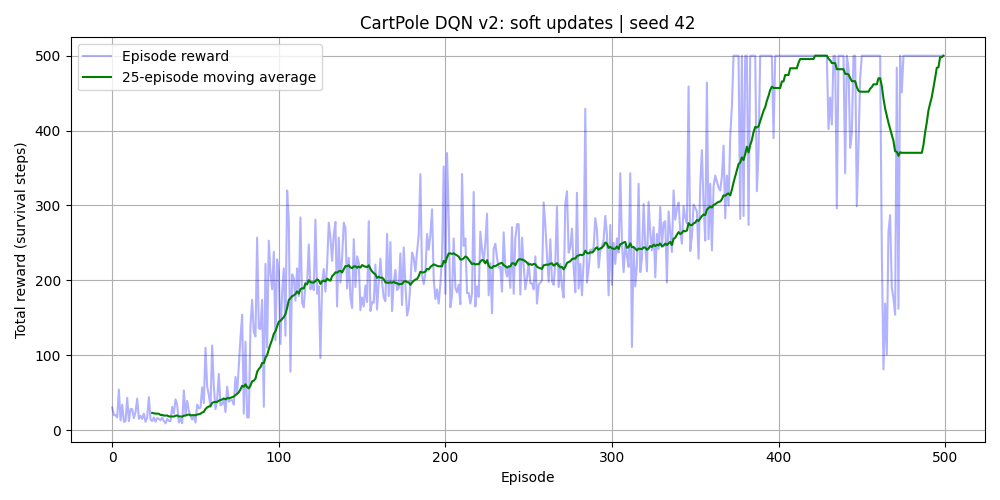

# Q-Learning and DQN Study

## Overview

Three small reinforcement-learning implementations:

- A Q-table for **Taxi-v3**, with 500 discrete states and six actions.
- A **CartPole-v1 DQN** with periodic hard target-network updates.
- A second CartPole DQN with soft updates, a lower learning rate and a larger
  replay buffer.

Taxi and CartPole are different tasks. Their reward values cannot rank tabular
Q-learning against DQN. The two CartPole configurations are the direct comparison.

## Workflow

```text
Observation -> epsilon-greedy action -> environment step -> reward and next state
            -> Q-table update, or replay sample and neural-network update
            -> next episode -> training reward curve
```

Taxi stores an action value for each discrete state. CartPole instead uses a
small neural network to estimate action values from four continuous measurements.

Both DQNs use a replay buffer and a separate target network. The online network
learns from the reward plus the discounted next-state estimate. A true terminal
state has no next-state return; an external time limit stops the episode but does
not zero that estimate. See [Gymnasium's time-limit explanation](https://gymnasium.farama.org/v0.26.3/tutorials/handling_time_limits/).

## Configurations

| Setting | Taxi | DQN v1 | DQN v2 |
|---|---:|---:|---:|
| Episodes | 2,000 | 500 | 500 |
| Learning rate | 0.1 | 0.001 | 0.00025 |
| Discount factor | 0.6 | 0.99 | 0.99 |
| Replay capacity | — | 10,000 | 50,000 |
| Replay batch size | — | 64 | 64 |
| Target update | — | Copy every 1,000 environment steps | Blend 1% after each optimization step |
| Hidden layers | — | 64, 64 with ReLU | 64, 64 with ReLU |

Taxi has a local 99-step episode cap. CartPole-v1 has a 500-step environment cap.
Exploration decreases exponentially toward epsilon 0.01. The default seed is
42; Python, NumPy, PyTorch and the environment action sampler are seeded.
The DQNs run on CPU with two PyTorch threads.

## Results

The three plots are from the supplied scripts with their default episode counts
and seed 42. They show **training rewards**, including exploratory actions.
They are not a separate greedy-policy evaluation or a multi-seed benchmark.

| Run | Final averaging window | Mean reward in that window | Best episode reward | Episodes reaching the 500-step cap |
|---|---|---:|---:|---:|
| Taxi Q-learning | Last 200 episodes | -6.68 | 15 | Not applicable |
| CartPole DQN v1 | Last 50 episodes | 119.34 | 411 | 0 |
| CartPole DQN v2 | Last 50 episodes | 435.16 | 500 | 98 |

v2 has higher late-training reward in this run. This does not establish which
of its three changed settings caused the difference or how other seeds behave.



| DQN v1: hard updates | DQN v2: soft updates |
|---|---|
|  |  |

The 50-episode Taxi and 25-episode CartPole moving averages smooth the curves;
they do not remove individual low-reward episodes.

## Project layout

```text
01_tabular_rl/taxi_q_learning.py   # Complete Q-table training script
02_deep_rl/cartpole_dqn.py         # Complete hard-update DQN script
02_deep_rl/cartpole_dqn_v2.py      # Complete soft-update DQN script
plots/                            # Three recorded training curves
requirements.txt
README.md
```

Each script can be read and run independently. The DQN files intentionally keep
their small replay buffer and network classes visible in the same file.

## Setup

Python **3.12** was used to run the supplied configurations. From the repository
root in Windows PowerShell:

```powershell
py -3.12 -m venv .venv
.\.venv\Scripts\python.exe -m pip install -r requirements.txt
```

On macOS/Linux, use `python3.12 -m venv .venv` and the interpreter at
`.venv/bin/python`. Environments are generated by Gymnasium; there is no dataset
to download and no external RL training framework.

## Usage

Run any script from the repository root:

```powershell
.\.venv\Scripts\python.exe 01_tabular_rl/taxi_q_learning.py
.\.venv\Scripts\python.exe 02_deep_rl/cartpole_dqn.py
.\.venv\Scripts\python.exe 02_deep_rl/cartpole_dqn_v2.py
```

Default runs write their corresponding image to the repository's `plots/`
directory, regardless of the current working directory.

To check execution briefly while keeping the recorded plots:

```powershell
.\.venv\Scripts\python.exe 02_deep_rl/cartpole_dqn.py --episodes 10 --seed 42 --output-dir .cache/quick-run
```

All three scripts accept `--episodes`, `--seed` and `--output-dir`.
A short run verifies execution but is not evidence that an agent has learned
a useful policy. Environments and figures are closed after each run.

## Limitations

- Each recorded curve uses one seed; other seeds and machines may differ.
- Training reward is not an independently measured final policy score.
- v2 changes three settings together. A difference cannot be attributed only
  to soft updates, the learning rate or buffer size.
- No claim is made that either DQN configuration is generally superior.
- Taxi's episode cap and continued exploration affect its reported rewards.
